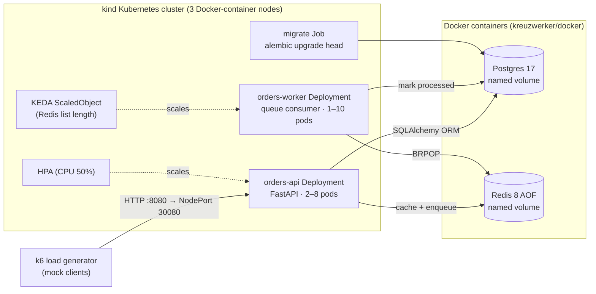

# Orders Platform: CI/CD with GitHub Actions, Terraform, Docker & Kubernetes

[](https://github.com/trevorflahardy/cis4930-cicd-k8s-autoscale/actions/workflows/ci-cd.yml)

CIS 4930 final project (**Option A: Local Docker**). This extends the Assignment 4 Terraform/Docker setup into a full pipeline. On every push or pull request, GitHub Actions tests and builds a mock order-processing service. Terraform then deploys it to a Kubernetes cluster that runs in Docker, backed by real Postgres and Redis containers. The pipeline proves the service works and **autoscales under simulated client load**, checks for drift, and tears everything down.

## Architecture



- **API** (`POST /orders`, `GET /orders/{id}`, `/stats`, `/health`, `/ready`). Each order runs a CPU-heavy PBKDF2 "pricing" step, writes to Postgres, caches in Redis, and pushes onto a Redis queue. Client traffic therefore turns into CPU load for the HPA.
- **Worker** pops orders off the queue and marks them processed. KEDA scales it on queue depth, i.e. on pending client requests.
- **Data tier** runs as Docker containers on the `kind` network. Pods reach it through selector-less Services and EndpointSlices, using IPs from Terraform outputs (no hardcoded addresses).
- **Schema** is SQLAlchemy 2.0 ORM models with Alembic migrations. A migration Job runs before each rollout.

## Pipeline (`.github/workflows/ci-cd.yml`)

Triggers: `push` to `main`, `pull_request` to `main`, `workflow_dispatch`.

| Job | What it does |
|---|---|
| **Lint & static analysis** | Ruff, ShellCheck, Hadolint, `terraform fmt -check`, `terraform validate` (3 stages), compose config |
| **Test** | Unit tests; Alembic `upgrade` → `check` (models vs migrations) → downgrade/upgrade round trip; integration tests against Postgres/Redis service containers; coverage gate 80% |
| **Build & scan** | Buildx image tagged with the commit SHA, Trivy scan (fails on fixable HIGH/CRITICAL) |
| **Deploy & verify** | `terraform apply` of `01-platform` → `02-addons` → `03-app`; smoke tests; k6 autoscale test; second `terraform plan` must be empty; evidence artifact + job summary; `terraform destroy` |
| **Publish** | `main` only: pushes the verified image to GHCR |

**How Actions reaches the deployment environment:** the deploy job runs on a GitHub-hosted `ubuntu-latest` runner. Terraform's `kreuzwerker/docker` and `tehcyx/kind` providers talk to that runner's local Docker daemon (`/var/run/docker.sock`) and create the cluster and containers there. No cloud credentials or repository secrets are needed. The environment is ephemeral and gets rebuilt and destroyed on every run.

## Terraform stages

| Stage | Providers | Resources |
|---|---|---|
| `infra/01-platform` | `kreuzwerker/docker`, `tehcyx/kind`, `random` | kind cluster (1 control plane + 2 workers, `127.0.0.1:8080` port mapping), Postgres + Redis containers, named volumes, generated passwords |
| `infra/02-addons` | `hashicorp/helm` | metrics-server, KEDA |
| `infra/03-app` | `hashicorp/kubernetes` | image load into nodes, namespace, ConfigMap/Secret, data-tier Services + EndpointSlices, migration Job, API + worker Deployments, NodePort Service, PDB, HPA, KEDA TriggerAuthentication + ScaledObject |

The stages are separate so each provider is configured from known values at plan time, and so KEDA's CRDs exist before the `ScaledObject` is planned. Later stages read earlier outputs via `terraform_remote_state`.

## Run it locally

Requires Docker, Terraform ≥ 1.6, kubectl, jq, and [uv](https://docs.astral.sh/uv/).

```bash
make up        # build image, terraform apply all 3 stages
make smoke     # end-to-end checks (Docker, Kubernetes, API, Postgres, Redis)
make load      # k6 burst; asserts HPA and KEDA scale out, queue drains
make drift     # second terraform plan -> "No changes" for every stage
make down      # terraform destroy (reverse order)
```

Other targets: `make lint`, `make test`, `make evidence`, and `make dev` (runs the app with `docker compose`, no Kubernetes, for quick iteration). The app is reachable at `http://127.0.0.1:8080` when deployed with Terraform.

## Layout

```
app/                 FastAPI service, worker, SQLAlchemy models, Alembic migrations, tests (uv)
infra/01-platform    kind cluster + Docker data tier
infra/02-addons      metrics-server + KEDA (Helm)
infra/03-app         Kubernetes workloads and autoscalers
scripts/             image load, smoke/autoscale/drift tests, evidence + summary
tests/load/          k6 scenario
compose.yaml         local dev stack (not used for deployment)
```
